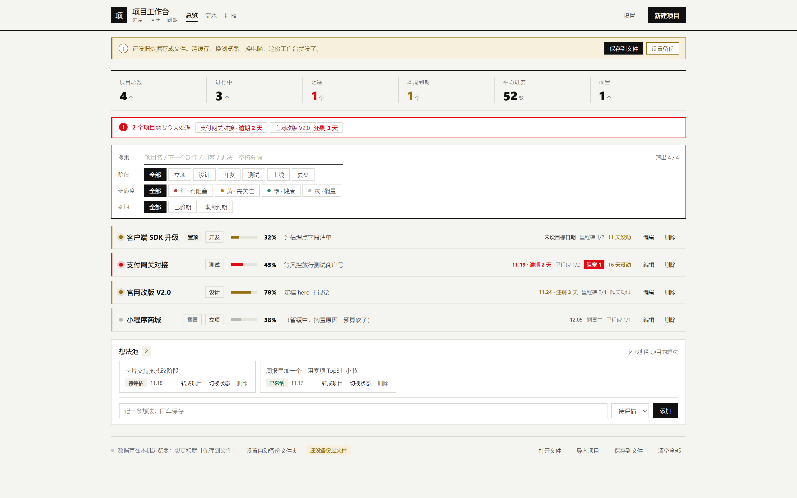

# 项目工作台

单文件、零依赖的本地项目管理工具。双击 `项目工作台.html` 即可在浏览器中使用，无需构建、无需服务器。

## 能做什么

- **总览**：按健康度（红 / 黄 / 绿 / 灰）实时推导的项目卡片墙；逾期、临近到期、长期停滞一屏可见；阶段可在设置里自定义（跟着数据走）
- **流水**：进度、里程碑、阻塞、想法全部沉淀为时间线，按天分组，支持今天 / 本周 / 近 7 天 / 全部
- **周报**：按本周有变更自动生成 Markdown，可复制、保存 .md 或打印为 PDF
- **数据安全**：localStorage + 可选的「绑定单个 JSON 文件」与「备份文件夹」（File System Access API，不支持的浏览器自动降级为下载）；每日快照保留 30 份；删除 / 清空 6 秒可撤销
- **多窗口保护**：两个窗口同时打开时会提示选择覆盖或载入，绝不静默盖掉对方的改动

## 数据放在哪

- 默认：`localStorage`（键 `pw_v3`），跟随浏览器 profile
- 更稳的用法：页脚「保存到文件」绑定一个 JSON，改动自动写回；或「设置备份文件夹」每日写一份带日期的快照，坚果云等同步盘即可上云
- 导出格式即导入格式：单项目 JSON 与整库备份互不混淆

## 使用说明

1. 直接双击打开 `项目工作台.html`
2. 点「载入示例数据」可体验完整流程（示例数据带本周流水，便于验证周报）
3. 快捷键：`/` 搜索 · `n` 新建 · `1/2/3` 切换页面 · `Ctrl+S` 立即写盘 · `Esc` 关闭弹层

## 技术说明

纯原生 HTML + CSS + JS（约 3300 行），无第三方库。健康度、汇总、周报均为实时推导、不落库；所有动态文本经转义插入 HTML，外链走协议白名单。